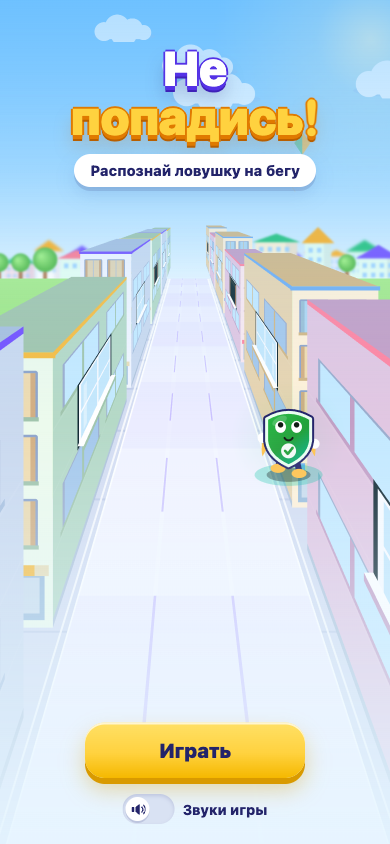
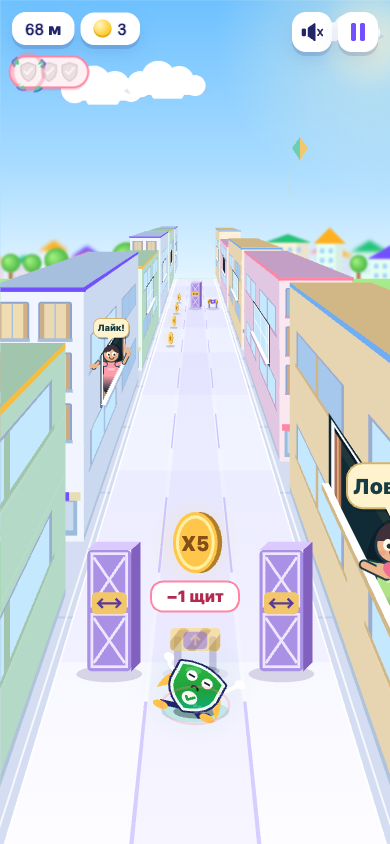
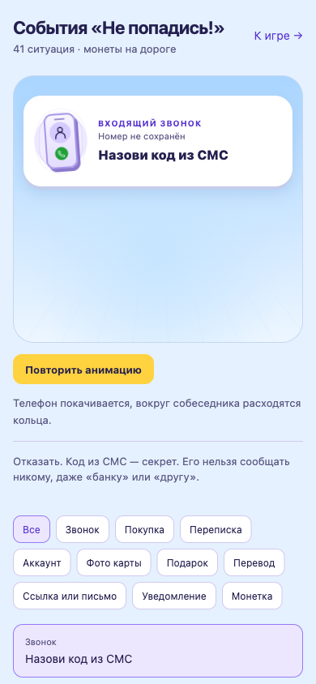
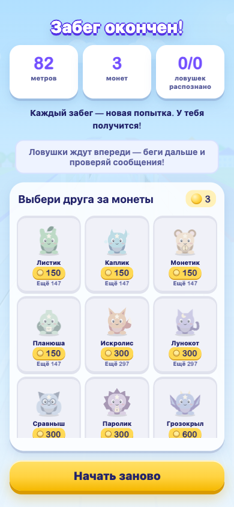

# 🛡️ Не попадись!

**Обучающая игра-раннер для детей 6–8 лет: учимся распознавать мошенников на бегу.**

Хакатонный проект для **СберKids** · трек «Игры» · команда **«Красавчики»**.
HTML5-игра, которая открывается внутри приложения (WebView) и превращает скучную тему
цифровой безопасности в динамичный раннер в духе Subway Surfers.

<p>
  
  
  
  
  
</p>

---

## 🎮 Попробовать за 10 секунд

```bash
cd game && python3 -m http.server 8000
# открыть http://localhost:8000 на телефоне или в мобильном режиме браузера
```

Или просто откройте **[`play.html`](play.html)** — вся игра в одном файле, работает офлайн, без сервера.
Управление: свайп влево/вправо — манёвр, свайп вверх — прыжок (на ПК: стрелки ← → ↑).

---

## 📸 Как это выглядит

| Старт | Забег | Ситуация | Награда |
|---|---|---|---|
|  |  |  |  |

🎤 Презентация защиты: **[docs/presentation.pptx](docs/presentation.pptx)**

---

## 💡 Проблема и решение

Дети рано получают доступ к деньгам и гаджетам — и становятся лёгкой целью мошенников.
Нотации не работают. Мы учим **навыку**, а не правилам: ребёнок на скорости принимает решения
и закрепляет привычку замечать подвох.

Герой бежит по городу, а навстречу летят **реальные ситуации** (звонок, сообщение, «приз»).
Нужно увести его на дорожку с правильным действием:

| 🛑 Отказать | 🔎 Проверить | ✅ Можно |
|---|---|---|
| код из СМС, пароль, «срочно переведи», фейк-приз | странная ссылка, «банк» в чате | мама, друг, уведомление в приложении |

Ошибся — короткая подсказка «почему это ловушка», и бежим дальше. **Можно ошибаться и пробовать снова.**

---

## ✨ Ключевые особенности

- 🏃 **Динамика как у любимых раннеров** — псевдо-3D улица, прыжки, монеты, комбо, персонажи в окнах.
- 🧠 **Обучение зашито в механику** — один приём обмана прилетает в десятках формулировок, ребёнок учится узнавать *паттерн*, а не зубрит карточку. **41 ситуация из жизни.**
- 🧩 **Инклюзивно под СДВГ** — короткие забеги, мгновенный рестарт, мягкий провал, во время чтения карточки дорога замедляется.
- 🦊 **16 зверушек-наград** — за собранные монеты ребёнок **сам выбирает** друга (без рулетки и ставок), у каждого полезный совет по финграмотности и безопасности.
- 🎨 **Управляемый контент** — новые ситуации и сезонные темы (например, к Новому году) добавляются правкой JSON, без релиза приложения.

---

## 🛠️ Технологии и инженерные решения

- **Чистые HTML + CSS + JavaScript + Canvas 2D** — ноль библиотек, фреймворков, CDN и внешних шрифтов.
- **Полностью офлайн** — ни одного сетевого запроса; вся игра ≈ **240 КБ** (бюджет площадки — 5 МБ).
- **60 fps** — пулинг частиц, кэш спрайтов, минимум работы с DOM.
- **Доступность** — поддержка `prefers-reduced-motion`, клавиатура, контраст.
- **Тесты без зависимостей** — 7 прогонов на `node:assert` (`tests/`): игровой цикл, препятствия, события, магазин, офлайн-сборка.
- **Сборка одним скриптом** — [`scripts/build.py`](scripts/build.py) инлайнит всё в автономный `play.html` (только stdlib Python).
- **Интеграция с приложением** — односторонний `postMessage` (вибрация, завершение, прогресс), без доступа к данным и платежам.

```
game/                 # игра
  index.html
  styles.css · events.css · rewards.css
  content.json        # все ситуации и тексты — меняются без релиза
  js/                 # game, runner, city, events, rewards, reward-shop …
tests/                # 7 тест-сьютов (node *.cjs)
scripts/build.py      # сборка автономного play.html
play.html             # вся игра в одном файле (офлайн)
docs/                 # презентация + скриншоты
```

---

## ✅ Соответствие требованиям площадки

Детская аудитория 0+/6+, ФЗ-436. Без дарк-паттернов и азартных механик: награды покупаются
за монеты **детерминированно** (выбираешь конкретного друга), никакой рулетки. Данные и платежи
не покидают устройство. Карточки нейтральные — ребёнок читает текст, а не угадывает по цвету.

---

## 🎯 Цель обучения

> После игры ребёнок на лету распознаёт типичные приёмы обмана — давление и срочность,
> выманивание кода и пароля, «слишком хороший» приз, поддельные ссылки — и выбирает
> безопасное действие: отказать и позвать взрослого.

---

<sub>Проект создан на хакатоне Sber «Создаём эмоции». Мошенничество подаётся как навык и победа
(«раскусил!»), а не как угроза.</sub>
